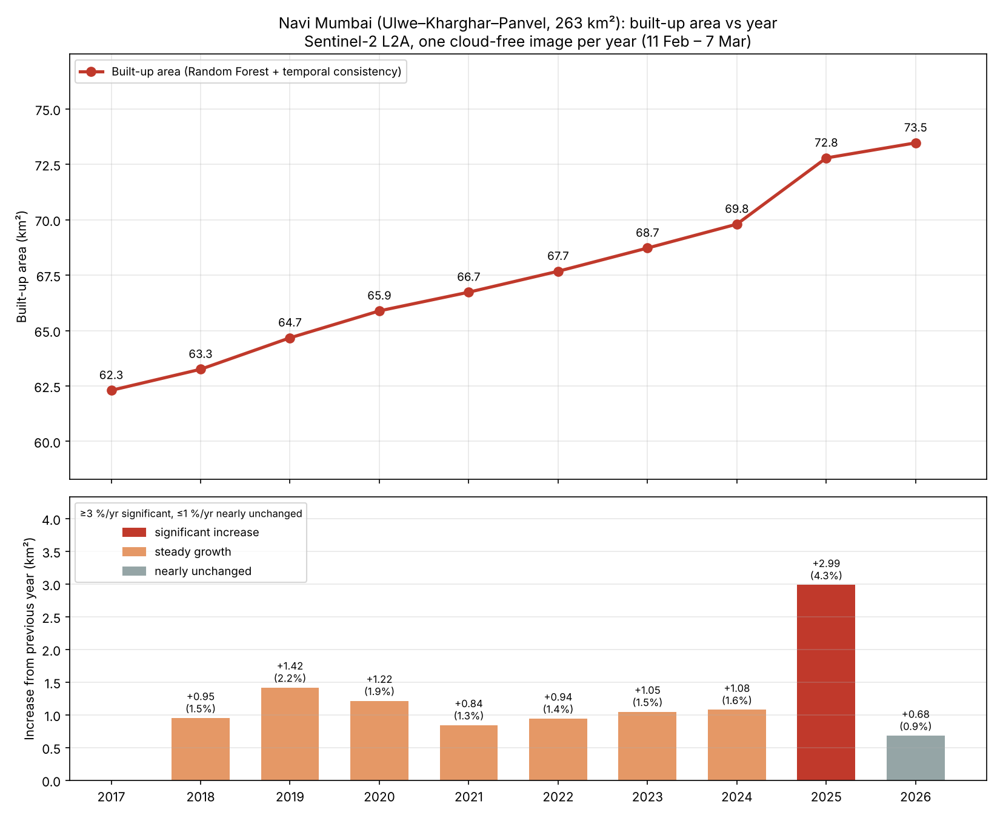

# Built-up area change in Navi Mumbai, 2017-2026 (Sentinel-2)

Course project for GNR607, Principles of Satellite Image Processing (IIT Bombay).
Task: take images of one area for five or more consecutive years at the same time of year,
find the change in built-up area, plot built-up area against year, and note when it grew
significantly and when it was nearly unchanged.

Study area: 72.98-73.15 E, 18.93-19.06 N (Ulwe, Kharghar, Panvel, new airport site), about 263 km2.
Data: Sentinel-2 L2A, tile T43QBB (EPSG:32643), one cloud-free scene per year, 11 Feb - 7 Mar.

## Result
| Year | Built-up km2 | Year | Built-up km2 |
|---|---|---|---|
| 2017 | 62.3 | 2022 | 67.7 |
| 2018 | 63.3 | 2023 | 68.7 |
| 2019 | 64.7 | 2024 | 69.8 |
| 2020 | 65.9 | **2025** | **72.8 (+2.99, significant)** |
| 2021 | 66.7 | 2026 | 73.5 (+0.68, nearly unchanged) |

Steady growth of about 1 km2 per year, a jump in 2025 (airport runway/terminal and Ulwe),
and little change in 2026. The 2026 value cannot be confirmed without a later image.
The trend is robust; the absolute level is not (changing confidence thresholds moves the 2017
level between 54 and 70 km2). Quote areas as a range.



## Method
1. **Acquire**: Sentinel-2 L2A scenes found through the Element84 STAC catalogue, windowed
   reads of the study box (`download_navi_mumbai_s2.py`). Bands B02, B03, B04, B08, B11, B12 and SCL.
2. **Clean**: DN to reflectance (scale 0.0001, -0.1 offset for newer processing baselines),
   20 m bands repeated onto the 10 m grid, SCL cloud/shadow/cirrus/no-data mask (`s2lib.py`).
3. **Normalise**: quantile histogram matching of every year to 2023 (`classify_pooled.py`).
4. **Classify**: one Random Forest (200 trees, bagging, Gini, min leaf 3) on 13 features
   (6 bands, NDVI, NDBI, MNDWI, BSI, SWIR2/SWIR1, local NIR std, Unser difference-histogram
   contrast); classes built-up, vegetation, water, bare/dry hills; 3x3 majority filter.
5. **Consolidate**: a pixel is new built-up in year k only if its built-up probability is low
   before k and high after k (`trajectory.py`).
6. **Quantify and check**: area per year, graph, maps, 100 validation points (`make_outputs.py`).

A simpler index rule (NDBI/NDVI/MNDWI + Otsu + morphology, `method_a.py`) was also tried.
It marks dry hills as built-up and gives 105-124 km2 with no trend.

## Limitations
- Training areas (`training_areas.py`) were drawn by eye on the images, not from ground truth.
- Reported accuracy (overall 87.5 %, kappa 0.83) comes from held-out halves of the same training
  rectangles, so it is optimistic. Independent checking: open `results/validation_points.kml` in
  Google Earth Pro, fill `results/validation_points.csv`, compute a confusion matrix.

## Run it
```
pip install -r requirements.txt
python run_all.py          # about 4 minutes, writes results/
```
The ten scenes are already in `data/` (`*.s2clip.gz`, about 170 MB). Their format is read by
`read_s2clip.py` (magic `S2CLIP1\n`, JSON header, uint16 band arrays).
To fetch the data again from the public archive instead, run `python download_navi_mumbai_s2.py`
(needs network access to the STAC API and the Sentinel-2 COG bucket).

## Files
- `s2lib.py`, `features.py`: loading, masking, indices, features
- `method_a.py`: index-rule method; `classify_pooled.py`, `trajectory.py`: final method
- `training_areas.py`: training rectangles; `make_outputs.py`: tables, figures, validation points
- `results/`: figures, `builtup_area_by_year.csv`, summaries, validation points
- `docs/`: image-selection overview
